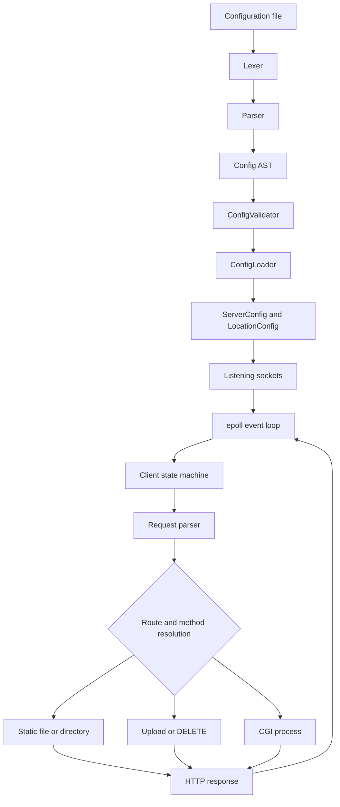

# Webserv

A small HTTP/1.1-style web server written from scratch in C++98 as part of the 42 curriculum by **houabell** and **achemlal**.

Webserv focuses on the mechanics behind an HTTP server: configuration parsing, non-blocking sockets, `epoll`-based event multiplexing, request parsing, static-file delivery, uploads, virtual hosting, CGI execution, keep-alive connections, timeouts, and error handling.

> This project implements a practical subset of HTTP/1.1 rather than attempting to replace a production web server such as NGINX or Apache.

## Contents

- [Features](#features)
- [Tech stack](#tech-stack)
- [Visual preview](#visual-preview)
- [Architecture](#architecture)
- [Project structure](#project-structure)
- [Prerequisites](#prerequisites)
- [Build and run](#build-and-run)
- [Configuration](#configuration)
- [Usage](#usage)
- [HTTP behavior](#http-behavior)
- [Testing](#testing)
- [Troubleshooting](#troubleshooting)
- [Deployment notes](#deployment-notes)
- [Roadmap](#roadmap)
- [Contributing](#contributing)
- [License](#license)
- [Authors](#authors)
- [Acknowledgments](#acknowledgments)

## Features

- Non-blocking sockets coordinated by a single Linux `epoll` instance.
- Incremental HTTP request parsing with request-line, header, body, and chunked-body states.
- `GET`, `POST`, `DELETE`, and `OPTIONS` handling in the response layer.
- Static-file serving with MIME type detection from [`conf/mime.types`](conf/mime.types).
- Configurable index files and directory auto-index generation.
- File uploads through the `upload_store` directive.
- File deletion through `DELETE` requests when permitted by a location.
- NGINX-style configuration syntax with lexing, parsing, validation, inheritance, and nested locations.
- Multiple server blocks, listening sockets, ports, and hostname-based virtual-server selection.
- CGI execution through `fork`, pipes, `execve`, and configurable interpreters.
- HTTP keep-alive support.
- Connection and CGI inactivity timeouts.
- Request-size limits and custom error pages.
- URI decoding and path normalization intended to prevent traversal outside the configured route.
- Included shell scripts and fixtures for integration, timeout, CGI, upload, redirect, and error-path testing.

## Tech stack

| Area | Technologies verified in the repository |
| --- | --- |
| Runtime | Linux/POSIX environment |
| Language | C++98; shell scripts for testing; Python and PHP CGI fixtures |
| Networking | POSIX sockets, non-blocking file descriptors, Linux `epoll` |
| Configuration | Custom lexer, recursive parser, validator, and configuration loader |
| Static content | HTML, CSS, JavaScript, MIME mappings, directory listings |
| CGI | `fork`, `execve`, pipes, CGI/1.1-style environment variables |
| Build | GNU Make-compatible [`Makefile`](Makefile) |
| Test tools | `curl`, Bash, Python 3, and optionally `nc` for timeout tests |

There is no database, application framework, Docker configuration, package manager manifest, authentication system, or environment-variable configuration in the repository.

## Visual preview

The repository includes a browser-facing demo site under [`www/static`](www/static), including [`www/static/index.html`](www/static/index.html).

To add a screenshot to this README:

1. Run the server with [`configs/main.conf`](configs/main.conf).
2. Open `http://localhost:8080/` in a browser.
3. Save a screenshot as `docs/images/webserv-preview.png`.
4. Add the image file and uncomment the following line:

```markdown

```

No screenshot is included by default because the repository currently does not contain one.

## Architecture

The executable starts in [`src/main.cpp`](src/main.cpp). It loads a configuration file, converts it into an abstract syntax tree, validates the directives, materializes `ServerConfig` and `LocationConfig` objects, creates listening sockets, and enters the event loop.



### Request lifecycle

Each client is represented by a `Client` object and moves through the states declared in [`inc/Server.hpp`](inc/Server.hpp):

```text
READ_REQUEST_LINE
  -> READ_REQUEST_HEADER
  -> READ_BODY
  -> PROCESS_REQUEST
  -> PROCESS_CGI (when a CGI route matches)
  -> WRITE_RESPONSE
  -> CLOSED or READ_REQUEST_LINE (keep-alive)
```

The main runtime components are:

- [`src/config`](src/config): tokenizes, parses, validates, and loads configuration files.
- [`src/server/Request.cpp`](src/server/Request.cpp): parses request lines, headers, content lengths, and chunked bodies.
- [`src/server/Response.cpp`](src/server/Response.cpp): resolves locations, serves files, builds directory listings, handles uploads/deletes, redirects, errors, and CGI dispatch.
- [`src/server/Epoll.cpp`](src/server/Epoll.cpp): accepts events, dispatches client work, and performs timeout sweeps.
- [`src/server/CGI.cpp`](src/server/CGI.cpp): starts CGI processes and parses their output.

## Project structure

```text
.
├── Makefile                  # C++98 build rules for the webserv executable
├── README.md                 # Project documentation
├── conf/
│   └── mime.types            # Extension-to-MIME mappings
├── configs/                  # Example server configurations
│   ├── main.conf             # Main local integration configuration
│   ├── default_con.conf      # Default configuration used without an argument
│   ├── CGI.conf              # Python CGI example
│   ├── multi_server.conf     # Multiple ports/server blocks
│   ├── multi_host.conf       # Hostname-based virtual hosting
│   ├── comprehensive.conf    # Broad directive and inheritance example
│   ├── edge_cases.conf       # Body-limit, method, and redirect cases
│   └── status.conf            # HTTP status-code exercise configuration
├── inc/                      # Public headers and configuration data types
├── src/
│   ├── main.cpp              # Program entry point
│   ├── config/               # Lexer, parser, AST loading, validation
│   ├── server/               # Sockets, epoll, clients, requests, responses, CGI
│   └── utils/                # Parsing and URI/path helper functions
├── Testing/
│   ├── timeout_tester.sh     # Interactive timeout and keep-alive tests
│   └── webserv-testbench.html # Browser-oriented testbench page
├── test.sh                   # curl-based integration test suite
├── tester                    # Additional test artifact/script
├── tester_root/              # Small test document root
├── www/                      # Static, CGI, API, and error-page fixtures
├── www1/                     # Additional web-root fixture tree
├── cgi_tester                # CGI-related test artifact
├── Subject.pdf               # 42 project subject
└── code_brefore_testing.zip # Historical project artifact
```

## Prerequisites

The implementation uses Linux-specific `epoll` APIs, so run it on Linux or an environment that provides compatible Linux networking APIs.

Required for the normal build:

- A C++ compiler available as `c++` with C++98 support (GCC or Clang).
- GNU Make or a compatible `make` implementation.

Required for the documented integration tests:

- Bash.
- `curl`.
- Python 3 for the body-size test in [`test.sh`](test.sh) and Python CGI fixtures.

Required only for [`Testing/timeout_tester.sh`](Testing/timeout_tester.sh):

- `nc`/Netcat.
- Bash `/dev/tcp` support.
- The `timeout` command.

## Build and run

Clone the repository and build the executable:

```bash
git clone https://github.com/A-chem/42-Cursus-WebServer.git
cd 42-Cursus-WebServer
make
```

The build creates an executable named `webserv`. The Makefile compiles with:

- `-Wall`
- `-Wextra`
- `-std=c++98`
- `-I inc`

Run the server with the repository's main local configuration:

```bash
./webserv configs/main.conf
```

Then open the server in a browser or query it with `curl`:

```bash
curl -i http://localhost:8080/
```

If no configuration argument is supplied, the program loads [`configs/default_con.conf`](configs/default_con.conf):

```bash
./webserv
```

> For the most predictable repository-local demo, use `configs/main.conf`. The default configuration contains absolute roots such as `/var/www`, which may not exist on a fresh clone.

### Make targets

```bash
make          # Build webserv
make clean    # Remove object files
make fclean   # Remove object files and webserv
make re       # Clean and rebuild
```

## Configuration

Configuration files use a block-and-directive syntax inspired by NGINX. Comments begin with `#`, directives end with `;`, and blocks use `{}`.

A minimal local configuration is:

```conf
server {
    listen 8080;
    server_name localhost;
    client_max_body_size 10m;

    location / {
        root www/static;
        index index.html;
        autoindex off;
        limit_except GET {
            deny all;
        }
    }
}
```

The supported directives are validated in [`src/config/ConfigValidator.cpp`](src/config/ConfigValidator.cpp):

| Directive | Purpose |
| --- | --- |
| `server` | Defines a server block. |
| `listen` | Selects a host/port socket. A bare port is accepted by the example configurations. |
| `server_name` | Provides hostnames for virtual-server selection. |
| `root` | Sets the filesystem root for a server or location. |
| `index` | Selects an index file when a directory is requested. |
| `autoindex` | Enables or disables generated directory listings. |
| `client_max_body_size` | Limits request bodies; values may include size suffixes such as `k`, `m`, or `g`. |
| `error_page` | Maps one or more HTTP status codes to a file path. |
| `return` | Returns a configured HTTP status and `Location` value. |
| `cgi_pass` | Maps a file extension to an interpreter or CGI executable. |
| `upload_store` | Selects the directory used for uploaded request bodies. |
| `limit_except` | Lists methods allowed by a location. The example uses `deny all;` inside the block. |
| `deny` | Marks the method restriction inside `limit_except`. |

### Configuration examples

- [`configs/main.conf`](configs/main.conf): local static files, auto-index, upload, delete, redirects, and error pages.
- [`configs/CGI.conf`](configs/CGI.conf): Python CGI under `/cgi-bin` using `cgi_pass .py /usr/bin/python3;`.
- [`configs/multi_server.conf`](configs/multi_server.conf): servers on ports `8080` and `9090`.
- [`configs/multi_host.conf`](configs/multi_host.conf): multiple server blocks sharing port `8000` and selecting by `Host`.
- [`configs/comprehensive.conf`](configs/comprehensive.conf): inheritance, nested locations, uploads, CGI, and redirects.
- [`configs/edge_cases.conf`](configs/edge_cases.conf): body limits, method restrictions, and redirect chains.

### Working-directory requirement

The server loads `conf/mime.types` using a relative path. Start `webserv` from the repository root, or ensure a matching `conf/mime.types` path exists from your chosen working directory.

## Usage

The examples below assume that the server is running with `configs/main.conf` on `localhost:8080`.

### Serve a static file

```bash
curl -i http://localhost:8080/
curl -i http://localhost:8080/index.html
```

### List a directory

The `/images` location in `configs/main.conf` enables auto-indexing:

```bash
curl -i http://localhost:8080/images/
```

Requesting a directory without its trailing slash produces a redirect:

```bash
curl -i http://localhost:8080/images
```

### Upload a file

The upload location accepts `POST` and stores the body under the configured `upload_store` directory. The implementation reads an optional filename from `Content-Disposition`; otherwise it generates an `upload_<timestamp>.bin` name.

```bash
curl -i -X POST \
  -H 'Content-Disposition: attachment; filename="example.txt"' \
  --data 'hello from webserv' \
  http://localhost:8080/upload
```

### Delete a file

The `/files` location in `configs/main.conf` permits `GET` and `DELETE`:

```bash
curl -i -X DELETE http://localhost:8080/files/deleteme.txt
```

### Follow a redirect

```bash
curl -i http://localhost:8080/redirect
curl -i http://localhost:8080/old-page
```

### Exercise a custom error page

```bash
curl -i http://localhost:8080/does-not-exist.html
```

### Test CGI

Use [`configs/CGI.conf`](configs/CGI.conf), ensure the configured CGI script is executable, and make sure the configured interpreter exists:

```bash
make
./webserv configs/CGI.conf
curl -i 'http://localhost:8080/cgi-bin/test_get.py?name=webserv'
curl -i -X POST --data 'message=hello' http://localhost:8080/cgi-bin/test_post.py
```

The CGI implementation exports variables including `REQUEST_METHOD`, `QUERY_STRING`, `CONTENT_TYPE`, `CONTENT_LENGTH`, `SCRIPT_FILENAME`, `GATEWAY_INTERFACE`, and `SERVER_PROTOCOL`.

## HTTP behavior

The server handles request processing incrementally and enforces the following limits in [`src/server/Request.cpp`](src/server/Request.cpp):

- Request line: 8 KiB.
- Individual header line: 8 KiB.
- Total headers: 64 KiB.
- Request body: controlled by `client_max_body_size` at server and location scope.

The response layer supports the following behaviors when configured and when the requested resource/method permits them:

- `200 OK` for static files, auto-index pages, and successful CGI output.
- `201 Created` for successful uploads.
- `204 No Content` for supported `DELETE`, `OPTIONS`, and non-upload `POST` responses.
- `301`, `302`, `307`, and `308` status text handling; configured examples primarily use `301` and `302`.
- `400`, `403`, `404`, `405`, `413`, `421`, `431`, `500`, and `504` error responses.
- `Connection: keep-alive` for eligible HTTP/1.1 requests.

The implementation is not an authentication service and does not define a separate REST API or database-backed schema. Routes are configured filesystem/CGI locations rather than application endpoints with a shared JSON contract.

## Testing

### Integration test suite

Start a server using the configuration expected by the test fixture:

```bash
make
./webserv configs/main.conf
```

In a second terminal, run:

```bash
./test.sh
```

You can override the host and port:

```bash
./test.sh localhost 8080
```

The script checks static files, MIME types, error pages, auto-indexing, redirects, uploads, deletes, method restrictions, keep-alive, path traversal, and body-size handling. The body-size case is skipped unless a server is also reachable on port `8181`, for example:

```bash
./webserv configs/edge_cases.conf
```

### Timeout and keep-alive tests

Run the server in one terminal:

```bash
./webserv configs/main.conf
```

Run the interactive tester in another:

```bash
./Testing/timeout_tester.sh
```

This script exercises normal requests, idle connections, slow partial requests, multiple simultaneous idle connections, activity resets, rapid connections, and persistent keep-alive behavior. It requires `nc`, `timeout`, and Bash `/dev/tcp` support.

### Test fixture page

[`Testing/webserv-testbench.html`](Testing/webserv-testbench.html) is an additional browser-oriented testbench. Serve it from a configured web root if you want to use it interactively.

There is no CI workflow or dedicated unit-test framework in the repository, so test results are produced by local execution of the included scripts rather than by a hosted build badge.

## Troubleshooting

### `Could not load mime.types`

Start the server from the repository root:

```bash
./webserv configs/main.conf
```

The runtime looks for `conf/mime.types` relative to the current working directory.

### `couldn't open file` or `No valid server blocks found`

Check that the configuration path exists and that it contains a valid `server { ... }` block:

```bash
./webserv configs/main.conf
```

Configuration errors are reported during lexing, parsing, validation, or loading.

### Port binding fails

Another process may already use the configured port. Change the `listen` port in the configuration or stop the conflicting process before restarting the server.

### Static files return `404`

Verify the configured `root` points to an existing directory and remember that the requested URI is resolved relative to the matching `location` root. For the repository demo, use the relative roots in [`configs/main.conf`](configs/main.conf).

### Uploads return `500`

Verify that the `upload_store` directory exists and is writable by the process. The included `status.conf` intentionally contains a broken upload directory for error testing.

### CGI returns `403`, `404`, or `500`

Check all of the following:

- The requested script exists under the resolved location root.
- The script has execute permission (`chmod +x path/to/script.py`).
- The interpreter in `cgi_pass` exists, for example `/usr/bin/python3`.
- The extension mapping matches the requested file extension.
- The CGI configuration is loaded from the configuration file passed to `webserv`.

### CGI returns `504`

The server kills a CGI process that remains inactive beyond the CGI timeout. [`www/cgi-bin/infinite.py`](www/cgi-bin/infinite.py) is an intentional infinite-loop fixture for timeout behavior; do not use it as a normal endpoint.

### A request is rejected as too large

Increase `client_max_body_size` at server or location scope, or send a smaller request. Location-level settings override the server-level value.

## Deployment notes

This repository does not include Dockerfiles, compose files, service definitions, CI deployment workflows, or a release packaging system. A practical manual deployment on a Linux host is:

1. Install a C++98-capable compiler, Make, and any required CGI interpreters.
2. Copy or clone the repository to the host.
3. Build with `make`.
4. Create a host-specific configuration with valid absolute `root`, `upload_store`, `error_page`, and `cgi_pass` paths.
5. Ensure web roots, upload directories, and CGI scripts have appropriate permissions.
6. Start `./webserv path/to/production.conf` from a working directory containing `conf/mime.types`, or adapt the runtime path in the source before packaging.
7. Put a process supervisor and a TLS-capable reverse proxy in front of the server if internet-facing HTTPS, restart management, access logging, or production hardening is required.

The repository should be treated as an educational HTTP-server implementation, not as a hardened internet-facing replacement for a mature production web server.

## Roadmap

No project roadmap or planned-feature list is currently tracked in the repository. Potential future work should be proposed through GitHub issues before being described as a committed feature.

## Contributing

Contributions should preserve the project's C++98 target and Linux/POSIX runtime assumptions.

1. Fork the repository.
2. Create a focused branch:

   ```bash
   git checkout -b feature/short-description
   ```

3. Make the change and update relevant configuration examples or test scripts.
4. Build and run the applicable checks:

   ```bash
   make re
   ./test.sh
   ```

5. Review the diff for generated files, temporary uploads, credentials, and unrelated changes.
6. Commit with a clear message.
7. Push the branch and open a pull request describing the behavior change, configuration impact, and tests performed.

For changes to request parsing, routing, CGI execution, uploads, or path handling, include a reproducible `curl` command or test-fixture update where possible.

## License

No license file is currently present in the repository, and the GitHub repository metadata does not specify a license. Until a license is added, reuse and redistribution rights should be considered unspecified.

## Authors

- **houabell**
- **achemlal**

The project README identifies both authors as the creators of the 42 curriculum project. No additional contact address is specified in the repository.

## Acknowledgments

- [42 Network](https://42.fr/) for the educational project context.
- [RFC 7230](https://datatracker.ietf.org/doc/html/rfc7230) for HTTP/1.1 message syntax and routing reference.
- [RFC 3875](https://datatracker.ietf.org/doc/html/rfc3875) for CGI/1.1 reference.
- The MIME type definitions adapted into [`conf/mime.types`](conf/mime.types).
